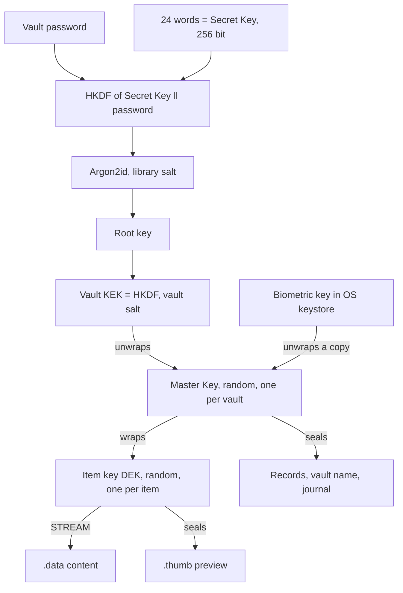

# Cryptography

How Cozy Safe protects a vault: the algorithms, the keys, how they connect, and what an
attacker who holds the files can and cannot learn. The files themselves are described in
[data-model.md](data-model.md). Why each choice was made is in the ADRs, mainly
[ADR 0001](adr/0001-encryption.md) (encryption), [ADR 0003](adr/0003-sync.md) (sync) and
[ADR 0008](adr/0008-vault-identity.md) (identity).

Words used here:

- **Secret Key / Recovery Key / 24 words**: one random 256-bit key per library, shown to
  people as 24 words. Code calls it `SecretKey`.
- **KDF** (key derivation function): turns one secret into another key. **Argon2id** is a
  slow, memory-hungry KDF for passwords. **HKDF** is a fast KDF for keys that are already
  random.
- **Wrap**: encrypt a key with another key.
- **Seal / AEAD**: encrypt and authenticate. Any change to sealed bytes, or opening them
  with the wrong **associated data (AAD)**, fails. AAD is a label that is checked but not
  stored inside the ciphertext.
- **Master Key (MK)**: one random 256-bit key per vault. It never changes.
- **DEK** (data encryption key): one random 256-bit key per item.

## Overview



- **One cipher for everything:** XChaCha20-Poly1305, 256-bit keys, random 192-bit nonces.
- **Two secrets open a vault:** the password **and** the 24 words. A copy of the files
  alone needs both. Each password guess costs one Argon2id run (128 MiB on phones).
- **Keys in layers:** password + words → Master Key → one key per item. Changing the
  password or the words re-wraps only the Master Key. No item is re-encrypted.
- **Every sealed blob names its place** in its AAD (vault id, item id, role), so blobs
  cannot be swapped between items or vaults.
- **What stays visible:** counts, sizes (within a few bytes), times and random ids. Not
  names, kinds, tags or content.
- **Post-quantum:** the vault itself is all symmetric, so it is not exposed to quantum
  computers. The vault identity keys and adding a new device on the Wi-Fi are hybrid
  (classical and post-quantum together). What is left: the TLS to Google (see
  [Post-quantum status](#post-quantum-status)).
- **Pure Rust core**, no `unsafe`, keys wiped from memory when dropped (`zeroize`).
  Memory is not locked, so keys may be paged out.

## 1. Primitives

| Algorithm | Crate | Parameters | Used for |
|---|---|---|---|
| Argon2id (RFC 9106, v0x13) | `argon2` 0.6 | Phone floor: m = 128 MiB, t = 3, p = 1. Desktop floor: m = 512 MiB, t = 3, p = 4. 32-byte output. | Password + Secret Key → root key; PIN + device key → PIN root (retired). |
| XChaCha20-Poly1305 | `chacha20poly1305` 0.10 | 256-bit key, 192-bit random nonce, 128-bit tag | Sealing every small value and wrapping every key (`wrap`). |
| STREAM with XChaCha20-Poly1305 | `chacha20poly1305` (`stream`, big-endian 32-bit counter) | 64 KiB chunks, 19-byte random nonce prefix | Item content (`.data`) of any size, in constant memory. |
| HKDF-SHA256 | `hkdf` 0.13, `sha2` 0.11 | 32-byte output, labels below | Every derived key. |
| SHA-256 | `sha2` | | Fingerprints, file hashes, password blocklist, BIP39 checksum. |
| Ed25519 (RFC 8032) | `ed25519-dalek` 3.0.0 | `verify_strict` | Vault identity signatures (half of a hybrid pair). |
| ML-DSA-65 (FIPS 204) | `ml-dsa` 0.1.2 | Deterministic signing, context `cozysafe/v1` | Vault identity signatures (other half). |
| X-Wing (ML-KEM-768 + X25519, draft-connolly-cfrg-xwing-kem-11) | `ml-kem` 0.3.4, `x25519-dalek` 3.0.0, `sha3`, `shake` | 32-byte seed, SHA3-256 combiner | Sealing a message to a vault identity. |
| X-Wing, ephemeral | `cs_identity::xwing` | Fresh key pair per session, the new device commits to a nonce first | Adding a new device over the Wi-Fi ([ADR 0010](adr/0010-post-quantum-device-add.md)). |
| TLS 1.3 | `rustls` 0.23 with `ring` | Mozilla roots bundled | HTTPS to Google (content is already sealed). |
| OS CSPRNG | `OsRng` (via `getrandom`) | | Every key, salt, nonce and id. |

### Argon2id limits

| Name | m (KiB) | t | p | Meaning |
|---|---|---|---|---|
| `PHONE_FLOOR` | 131072 (128 MiB) | 3 | 1 | Cost of a library made on iOS or Android. |
| `DESKTOP_FLOOR` | 524288 (512 MiB) | 3 | 4 | Cost of a library made on macOS, Windows or Linux. |
| `ACCEPTED_FLOOR` | = `PHONE_FLOOR` | | | Least cost accepted when opening a library, joining from a sync lock or restoring a backup. Lower means tampering: refused with `KdfTooWeak`. |
| Upper bounds | ≤ 4194304 (4 GiB) | ≤ 32 | ≤ 16 | A hostile header cannot exhaust memory or time. |

The cost is chosen when the library is made, stored in `library.json`, and used for every
vault in it. Lanes run one after another (no threads); the output depends only on `p`.
Test builds lower `ACCEPTED_FLOOR` through the `test-kdf` feature; the app checks at
compile time that it has the real one.

### Sealed value layout (`wrap::seal`)

```text
version (1 byte = 1) ‖ nonce (24) ‖ ciphertext ‖ tag (16)
```

The version byte is put in front of the caller's AAD, so it is authenticated too.

### Stream layout (`stream::encrypt`)

```text
version (1 byte = 1) ‖ nonce prefix (19) ‖ chunk₀ ‖ chunk₁ ‖ … ‖ chunkₙ
```

Each chunk is up to 64 KiB of plaintext plus a 16-byte tag. The nonce of each chunk is
the prefix, a 32-bit counter and a last-chunk flag, so chunks cannot be reordered,
dropped, duplicated or cut off. The same AAD goes into every chunk. Ciphertext size =
`20 + plaintext + 16 × chunks` (an empty file still has one chunk). A chunk's plaintext
is written out only after it authenticates.

### HKDF labels

| Label (info) | Input key | Salt | Result |
|---|---|---|---|
| `cozysafe/v1/secret-key` | Secret Key | none | 32 bytes put in front of the password before Argon2id. |
| `cozysafe/v1/vault-kek` | Root key | vault salt | The vault's key-encryption key (KEK). |
| `cozysafe/v1/subkey/<label>` | Master Key (or another key) | none | Named subkeys, see below. |
| `cozysafe/v1/p2p-restore` | Secret Key | none | Pairing key for a device that is restoring (has only the 24 words). |
| `cozysafe/v1/secret-key-fingerprint` | Secret Key | none | 2 bytes = 4 hex: the fingerprint in `library.json`, locks and backups. |
| `cozysafe/v1/identity/ed25519`, `…/ml-dsa-65`, `…/x-wing` | Identity seed | none | The three identity key seeds. |
| `cozysafe/v1/seal/<purpose>` | X-Wing shared secret | none | Key that seals a message to an identity. |

Subkey labels in use (`kdf::subkey`):

| Label | From | Used for |
|---|---|---|
| `identity/v1/<vault id>` | Master Key | Identity seed. |
| `p2p/v1/<vault id>` | Master Key | Nearby-device pairing key. Only a device holding the vault can derive it. |
| `hello/…`, `probe/…`, `session/to-joiner/…`, `session/to-host/…`, `session/check/…`, `session/restored/…`, `restore-proof/…` | Pairing key | Nearby-device handshake, per-direction session keys, the 3-digit check number. |
| `p2p-add/v2/key/<T>`, `p2p-add/v2/code/<T>` | X-Wing shared secret; `T` = SHA-256 of the token, public key, ciphertext and both nonces | Adding a device: session key and 8-digit code. |

Source: `core/cs-crypto/src/lib.rs` (`KEY_LEN`, `SECRET_KEY_LEN`, `SALT_LEN`,
`SecretKey::fingerprint`), `core/cs-crypto/src/kdf.rs` (`KdfParams`, `derive_root`,
`vault_kek`, `subkey`, `restore_pairing_key`), `core/cs-crypto/src/wrap.rs`,
`core/cs-crypto/src/stream.rs` (`CHUNK_LEN`, `HEADER_LEN`, `ciphertext_len`),
`core/cs-crypto/Cargo.toml`, `core/cs-identity/src/lib.rs`, `core/cs-net/src/p2p.rs`,
`core/cs-net/src/https.rs`.

## 2. Key hierarchy

### Unlock with the password

1. `input = HKDF(SecretKey, "cozysafe/v1/secret-key") ‖ password`.
2. `root = Argon2id(input, library salt, cost from library.json)`. This is the slow step
   (about 0.2 s on a phone). It runs **once** per unlock, whatever the number of vaults.
3. For each vault: `KEK = HKDF(root, salt = vault salt, "cozysafe/v1/vault-kek")`, then try
   to unwrap `wrapped_master_key`. The vault whose wrap opens is the one the password
   belongs to. Nothing on disk says which vault that is.
4. With the Master Key: open the vault meta (name, mode), then each record, then each
   item's DEK as needed.

The 24 words are not stored in the library. The app reads them from the OS keystore and
hands them to Rust at start ([data-model.md, section 8](data-model.md#8-secrets-kept-by-the-operating-system)).

A short fingerprint (16 bits) of the Secret Key sits in `library.json`. It tells a wrong
Recovery Key from a wrong password. It is a hint, not a check: opening is always the AEAD
unwrap, and 16 bits tell a guesser almost nothing.

### Below the Master Key

| Key | How it is made | Protects |
|---|---|---|
| Master Key | Random 256 bits when the vault is made. Never changes. | Vault meta, item records, held records, journal and head files, the connection log; wraps every DEK. |
| DEK | Random 256 bits per item. Kept when the content is edited. | `.data` (STREAM) and `.thumb` (sealed). |
| Identity seed | `subkey(MK, "identity/v1/<vault id>")` | Identity keys (section 7). |
| Nearby pairing key | `subkey(MK, "p2p/v1/<vault id>")` | Nearby-device sync sessions. |

### Biometric unlock

`enable_biometric` makes a random 32-byte key K, wraps the Master Key with it (AAD role
`biometric`) into `vaults/<id>/biometric`, and gives K to the app. The app keeps K in the
keystore behind biometrics:

- iPhone: Keychain, `biometryCurrentSet` (a new fingerprint or face invalidates it).
- Android: Keystore, strong biometrics only, a fresh check for every read.
- Mac: K is wrapped by a Secure Enclave P-256 key usable only with Touch ID (ECDH with a
  one-off key, HKDF-SHA256, AES-GCM); the blob sits in the legacy keychain.

Neither half opens the vault alone: the file is useless without K, and K is useless
without the file. Biometric unlock needs neither the password nor the 24 words. Only one
vault per device has it. A lost K deletes every `biometric` file and falls back to the
password.

### PIN unlock (retired)

The app no longer offers a PIN (decisions 2026-10-28). For vaults made with only a PIN,
the core still reads `vaults/<id>/pin`: `root = Argon2id(HKDF(device key) ‖ PIN, PIN
salt)`, `KEK = HKDF(root, PIN salt)`, Master Key wrapped with AAD role `pin`. The device
key is random, kept in the keystore and wrapped by a hardware key (Secure Enclave ECIES on
iPhone, Android Keystore AES-GCM). PIN files of vaults that have a password are deleted.

### Changing the password

`set_password` derives a new root from the new password, a new KEK with the **same**
vault salt, and re-wraps the same Master Key. Nothing else changes, so it is instant.
Biometric unlock keeps working. Backups and sync locks made before still open with the
old password.

### Changing the 24 words (Recovery Key)

Crash-safe, in this order:

1. Each password vault in the library keeps its old wrap in `prev_wrapped_master_key`
   and gets a new wrap under the new words (`rewrap`). Every password vault must be
   given its password first.
2. `library.json` records both fingerprints (`prev_secret_key`).
3. The app stores the new key in the keystore.
4. The next open with the new key drops the old wrap and fingerprint.

Stopped anywhere, the key the device holds still opens the vault.

### Top Secret Mode

The cryptography is **the same** in both modes. Top Secret Mode changes what the app does
with what is inside the vault ([ADR 0006](adr/0006-top-secret-mode.md),
[ADR 0007](adr/0007-mode-per-vault.md)):

- Nothing inside the vault is decoded in the app (no thumbnails, no previews).
- The 24 words are never copied to iCloud Keychain / Google Block Store, and an existing
  copy is removed when such a vault opens.
- The password is not offered to the system's password manager.
- The mode itself is sealed in the vault meta. Nothing in the clear says which mode a
  vault is in.

Source: `core/cs-crypto/src/kdf.rs`, `core/cs-core/src/vault.rs` (`create_unchecked_with`,
`find_key`, `set_password`, `change_secret_key_all`, `rewrap`, `accept_key`,
`enable_biometric`, `unlock_biometric`, `identity_seed`, `p2p_key`),
`core/cs-core/src/pin.rs`, `core/cs-core/src/items.rs` (`add_item_timed`, `unwrap_dek`),
`app/lib/biometric.dart`, `app/lib/secret_key_store.dart`, `app/lib/key_backup.dart`,
`app/lib/top_secret_mode.dart`, `app/lib/screens/new_vault.dart`.

## 3. Associated data (AAD)

Every vault blob's AAD is `cozysafe/v1/vault/<vault id>/<role>` (`vault::aad`). The
version byte `1` is put in front by `wrap` and `stream`.

| Blob | Role in the AAD | Swap it stops |
|---|---|---|
| `wrapped_master_key`, `prev_wrapped_master_key` (header) | `master-key` | Putting another vault's wrapped key into this header. |
| Vault meta (header) | `meta` | Moving one vault's name and mode onto another. |
| `biometric` file | `biometric` | Using a biometric copy for another vault, or as a password wrap. |
| `pin` file | `pin` | Same, for the PIN copy. |
| `wrapped_dek` (in the record) | `item/<item>/dek` | Moving an item key to another item. |
| `.meta`, index row, sync record, history record | `item/<item>/meta` | Swapping records between items or vaults. |
| `.data` (every chunk) | `item/<item>/data` | Swapping content or chunks between items or vaults. |
| `.thumb` | `item/<item>/thumb` | Showing one item's preview for another. |
| `.held` | `item/<item>/held` | A held record passing for a live one. |
| Journal entry | `sync/log/<device>/<n>` | Replaying an entry under another device or number. |
| Head | `sync/head/<device>` | Presenting one device's head as another's. |

Other AAD:

| Blob | AAD |
|---|---|
| Connection log (in `vault.db`) | `connection-log` (under the vault's own Master Key). |
| Nearby-device frames | `cozysafe/p2p/v1/frame/<direction>/<n>` (numbered: no replay or reorder). |
| Restore proof | `cozysafe/p2p/v1/restore-proof`. |
| Sealed to an identity | Recipient fingerprint ‖ X-Wing ciphertext. |

Not bound: the Argon2id cost is not part of any AAD. A lowered cost in a tampered header
is caught by the `ACCEPTED_FLOOR` check instead. There is no rollback counter: an older
copy of a header still opens with the password it was made with.

Source: `core/cs-core/src/vault.rs` (`aad`), `core/cs-core/src/items.rs` (`item_aad`),
`core/cs-vault/src/sync.rs` (`log_aad`, `head_aad`), `core/cs-net/src/p2p.rs`,
`core/cs-identity/src/lib.rs` (`seal_aad`).

## 4. What is encrypted, what is visible

| Data | On the device | In a backup | In the cloud (Google Drive) |
|---|---|---|---|
| Item names, kinds, tags, favourites, notes, file content, secure-item fields | Sealed | Sealed | Sealed |
| Vault name, icon, colour, mode | Sealed | Sealed | Sealed |
| Item ids, vault ids, revision ids, device ids | Visible (file names) | Visible | Visible (file names) |
| Number of items and vaults | Visible | Visible | Visible |
| Content size | Visible, within a few bytes (no padding) | Visible | Visible |
| Has a thumbnail | Visible (`.thumb` exists) | Visible | Visible |
| Created / modified / deleted times | Visible (`vault.db` columns, file times) | File order only | Upload times |
| Number of devices, how often they sync | Visible (`sync_meta`) | Not included | Visible (`log/`, `head/`) |
| Argon2 cost, salts, 4-hex key fingerprint | Visible (`library.json`) | Visible | Visible (lock file) |
| Which vault has biometrics or a PIN | Visible (file exists) | Not included | Not included |
| Version history | Sealed; file names show times and revision ids | Not included | Not included |
| Vault set to be deleted | Visible time in `delete-at/` | Not included | Not included |

On top of this, iOS Data Protection locks the vault files while the phone is locked, and
the library is excluded from iCloud / iTunes and Android backups
([security.md](security.md#files-at-rest-on-an-iphone-2026-11-02)).

## 5. Backups, sync and other ways out

**Backup file.** A plain container of files that are already sealed or public
([data-model.md, section 5](data-model.md#5-backup-file)). No extra encryption layer.
Opening it needs the 24 words and the password. Restore refuses odd paths and an Argon2
cost below the floor.

**Sync through a place** (Google Drive, or a nearby device's folder). The place receives
the same sealed bytes as on disk, plus sealed journal and head files and a plain lock.
Records carry the SHA-256 of their sealed content (`data_hash`, `thumb_hash`), so a place
cannot swap the content under a record without being caught. Records, journal entries and
heads are refused above 1 MiB, and a note read whole for a conflict copy above 64 MiB.
Google Drive access uses the `drive.file` scope (only the app's own files) over TLS 1.3. Details: [ADR 0003](adr/0003-sync.md).

**Joining from a place.** A new device reads the newest lock, checks its Argon2 cost,
derives the root from the 24 words and the password, and unwraps the Master Key. The lock
alone opens nothing.

**Nearby device.** Both devices prove they hold the vault with keys from
`subkey(MK, "p2p/v1/<vault id>")`, then talk in sealed, numbered frames. A device that is
restoring proves the 24 words (`cozysafe/v1/p2p-restore`), gets only the lock, and must
prove the Master Key before any item is served. **Adding a device** that has neither the
vault nor the words uses an X-Wing exchange (ML-KEM-768 + X25519; the new device sends
its public key and commits to a nonce first) and an 8-digit code typed on the new device;
then the password and the 24 words cross that channel ([ADR 0010](adr/0010-post-quantum-device-add.md)).

**Share inbox.** Not built. ADR 0001 describes one; there is no inbox code.

**Temporary files.** Decrypted copies for a player, a share or an import go to the app's
private temporary folder, emptied at start and on lock. On iPhone they are also
Data-Protection *complete* (unreadable once the phone locks).

**Clipboard.** Text copied out of the vault is cleared after 60 seconds and on lock,
unless something else was copied since. The 24 words may be copied, saved or shared
(owner choice, 2026-11-02); the words alone open nothing. A password, one-time code or
recovery code is copied another way (`SecureClipboard`, ADR 0009): it must outlive the
lock, so the system expires it instead (90 s by default; iPhone and Mac this device
only, Mac concealed and transient, Android marked sensitive and cleared in the
background too). Rules: [security.md](security.md#secrets-on-screen).

**Secure items** (ADR 0009). Encrypted like any item (own DEK, STREAM). Their record
holds a summary (account, host names), sealed with the Master Key like the name; the
document with the secrets is in `.data` only and reaches Dart through `entry_json`
alone. Rust refuses raw content, export and generic history reads for them.

**Cloud copy of the 24 words** (optional, everyday vaults only): iCloud Keychain or
Google Block Store, both end-to-end encrypted by Apple / Google. Whoever takes over that
account gets the words but still needs the password.

Source: `core/cs-vault/src/backup.rs`, `core/cs-vault/src/sync.rs` (`MAX_SMALL`,
`MAX_NOTE`), `core/cs-vault/src/join.rs`, `core/cs-net/src/p2p.rs` (`add_keys`,
`ADD_CODE_DIGITS`), `core/cs-net/src/drive.rs`, `app/lib/temp_files.dart`,
`app/lib/lock_guard.dart`, `app/lib/key_backup.dart`, `app/lib/words_export.dart`.

## 6. Passwords and the 24 words

- **24 words:** 256 random bits + 8 checksum bits = 24 words of the BIP39 English list.
  A word can be typed by its first four letters; a typo fails the checksum.
- **New password rule:** at least 12 characters, at least 5 different characters, and
  not in the 100,000 most common passwords (kept as 4-byte SHA-256 prefixes). Older
  vaults made under the 8-character rule still open. Unlocking never checks the rule.
- **Suggested password:** 5 words from the EFF large list (7,776 words, about 64.6 bits),
  picked with rejection sampling.
- **Wrong tries:** after 9 wrong passwords in a row (only tries of 8 characters or more
  count), the app makes you wait, longer each time (1, 5, 15, then 60 minutes), with a
  countdown the phone's clock cannot shorten.

Source: `core/cs-crypto/src/secret_key_text.rs`, `core/cs-core/src/passwords.rs`
(`MIN_PASSWORD_LEN`, `MIN_DISTINCT_CHARS`), `core/cs-vault/src/passphrase.rs`
(`SUGGESTED_WORDS`), `app/lib/secret_key_store.dart` (`PinStore.addPasswordFail`,
`TryWait`).

## 7. Identity keys

Every vault has identity keys ([ADR 0008](adr/0008-vault-identity.md)), derived from its
Master Key, so every device holding the vault, and a restore from the 24 words, gets the
same ones. Nothing new is stored.

| Part | Size (bytes) | Made from |
|---|---|---|
| Ed25519 public key | 32 | `HKDF(seed, "cozysafe/v1/identity/ed25519")` |
| ML-DSA-65 public key | 1952 | `HKDF(seed, "cozysafe/v1/identity/ml-dsa-65")` |
| X-Wing public key (ML-KEM-768 1184 + X25519 32) | 1216 | `HKDF(seed, "cozysafe/v1/identity/x-wing")` |
| Public identity | 3200 | The three keys in that order. |
| Signature | 3373 | Ed25519 (64) ‖ ML-DSA-65 (3309). Valid only if **both** verify. |
| X-Wing ciphertext | 1120 | In front of every message sealed to a vault. |

- **Fingerprint:** SHA-256 of `cozysafe/v1/identity\0` ‖ public identity.
- **Vault code** (`7F3A-9K2Q`): first 40 bits of the fingerprint in Crockford base 32. A
  label for people, not a check.
- **Signing** covers `cozysafe/v1/sign\0` ‖ signer fingerprint ‖ purpose (length-prefixed)
  ‖ message.
- **Sealing:** X-Wing encapsulation, then XChaCha20-Poly1305 under
  `HKDF(shared secret, "cozysafe/v1/seal/<purpose>")`.
- **Used today:** only to show the vault code (Settings, password manager user name, cloud
  copy label). Signing and sealing have no user yet.

Source: `core/cs-identity/src/lib.rs` (`ED25519_LEN`, `ML_DSA_LEN`, `ML_DSA_SIG_LEN`,
`PUBLIC_LEN`, `SIGNATURE_LEN`), `core/cs-identity/src/xwing.rs` (`PUBLIC_LEN`,
`CIPHERTEXT_LEN`), `app/rust/src/api/vault.rs` (`prepare_vault`).

## Post-quantum status

The rule every part must follow: [security.md](security.md#quantum-computers-the-rule-owner-2026-11-06)
(256-bit symmetric keys; every public-key step hybrid, both halves must hold).

| Part | Status |
|---|---|
| Vault content, records, keys (XChaCha20-Poly1305, HKDF-SHA256, Argon2id, 256-bit keys) | Symmetric only. Grover's algorithm leaves about 128-bit strength. Safe. |
| 24 words (256 bits) | About 128-bit against Grover. Safe. |
| Nearby sync between devices that hold the vault | Keys from the Master Key by HKDF. No public-key step. Safe. |
| Vault identity | Hybrid: Ed25519 + ML-DSA-65, X-Wing (ML-KEM-768 + X25519). Safe if either family holds. |
| Adding a new device on the Wi-Fi | Hybrid since 0.2.28: X-Wing (ML-KEM-768 + X25519), [ADR 0010](adr/0010-post-quantum-device-add.md). Until 0.2.27 X25519 alone; sessions recorded then are exposed to a future quantum computer. |
| HTTPS to Google | TLS 1.3 with `rustls` + `ring` (classical key exchange). What crosses is already sealed, except the OAuth tokens. |
| Biometric / hardware wraps (Secure Enclave P-256, Android Keystore AES-GCM) | Local to the device, never sent. |

## Threats and what stops them

Full list: [threat-model.md](threat-model.md). Rules for the app: [security.md](security.md).

| Threat | What stops it |
|---|---|
| A copy of the files (stolen backup, cloud folder, phone image) | Needs the 24 words **and** the password; each guess costs Argon2id. |
| Someone learns the 24 words | Still needs the password (Argon2id per guess). |
| Someone holds the locked phone | Password or biometrics needed; biometric key is useless off the device; iOS Data Protection. |
| A tampered `library.json`, lock or backup with a cheaper Argon2 cost | Refused below `ACCEPTED_FLOOR`. |
| Blobs swapped, reordered, truncated or moved between items or vaults | AEAD with AAD naming vault, item and role; STREAM counter and last-chunk flag. |
| A sync place rolling back or swapping content | `data_hash` / `thumb_hash` sealed in the record; files never overwritten. |
| A stranger on the Wi-Fi | Cannot find or pair without a key from the vault or the 24 words; frames sealed and numbered. |
| Someone in the middle while adding a device | Commitment + 8-digit code typed on the new device. |
| A crafted backup writing outside the library | Only exact library path shapes are accepted. |
| Not covered | Malware on the device, a forced unlock, losing both the words and the password, memory attacks on an unlocked phone. |

## Constants named in this document

| Constant | Value | Where |
|---|---|---|
| `KEY_LEN` | `32` | `core/cs-crypto/src/lib.rs` |
| `SECRET_KEY_LEN` | `32` | `core/cs-crypto/src/lib.rs` |
| `SALT_LEN` | `16` | `core/cs-crypto/src/lib.rs` |
| `FINGERPRINT_HEX` | `4` | `core/cs-crypto/src/lib.rs` |
| `PHONE_FLOOR` | `m_kib: 128 * 1024, t: 3, p: 1` | `core/cs-crypto/src/kdf.rs` |
| `DESKTOP_FLOOR` | `m_kib: 512 * 1024, t: 3, p: 4` | `core/cs-crypto/src/kdf.rs` |
| `MAX_M_KIB` / `MAX_T` / `MAX_P` | `4 * 1024 * 1024` / `32` / `16` | `core/cs-crypto/src/kdf.rs` |
| `CHUNK_LEN` | `64 * 1024` | `core/cs-crypto/src/stream.rs` |
| `HEADER_LEN` (stream) | `1 + PREFIX_LEN` = 20 | `core/cs-crypto/src/stream.rs` |
| Sealed value version, stream version | `1`, `1` | `wrap.rs`, `stream.rs` |
| HKDF labels | `cozysafe/v1/secret-key`, `cozysafe/v1/vault-kek`, `cozysafe/v1/subkey/`, `cozysafe/v1/p2p-restore`, `cozysafe/v1/secret-key-fingerprint` | `core/cs-crypto/src/kdf.rs`, `lib.rs` |
| Vault AAD prefix | `cozysafe/v1/vault/` | `core/cs-core/src/vault.rs` (`aad`) |
| Identity sizes | `ED25519_LEN = 32`, `ML_DSA_LEN = 1952`, `ML_DSA_SIG_LEN = 3309`, X-Wing `PUBLIC_LEN = 1184 + 32`, `CIPHERTEXT_LEN = 1088 + 32` | `core/cs-identity/src/` |
| `MIN_PASSWORD_LEN` | `12` | `core/cs-core/src/passwords.rs` |
| `SUGGESTED_WORDS` | `5` | `core/cs-vault/src/passphrase.rs` |

## Keeping this document current

- Any change to keys or algorithms updates this file **in the same commit**: a new or
  changed algorithm, crate or parameter, an Argon2 floor, an HKDF label, an AAD role, a
  new place a key is kept, a new way data leaves the vault.
- Storage format changes (a new kind, `ItemRecord` field, `vault.db` table or column,
  `SCHEMA_VERSION`, `RECORD_FORMAT`) update [data-model.md](data-model.md) in the same
  commit.
- A test checks that the constants in the table above match the code. If it fails, fix
  this file (or the code) before merging.
- Update [threat-model.md](threat-model.md) when a way in or out of a vault changes.
- Rationale belongs in an ADR; link it here instead of copying it.
