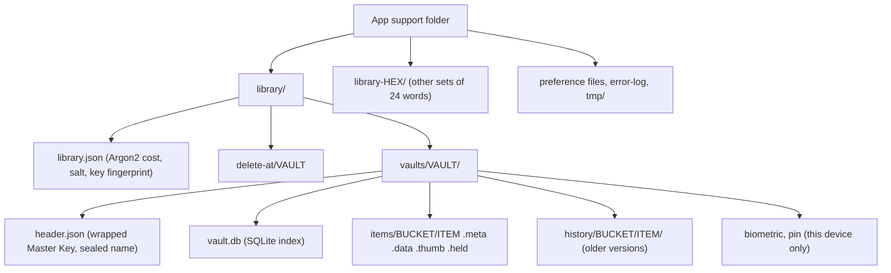

# Data model

How Cozy Safe stores a vault: every file, table and record it writes, on the device, in a
backup and in the cloud. How these are protected is in [cryptography.md](cryptography.md);
why they look this way is in the [ADRs](adr/).

Words used here:

- **Library**: a folder holding one or more vaults that share one set of 24 words (the
  Recovery Key, called the *Secret Key* in code) and one Argon2id salt.
- **Vault**: one folder inside a library, opened by its own password. It has a random
  32-hex-digit id.
- **Item**: one thing in a vault (a photo, a note, a tag, a login…), with a random
  32-hex-digit id.
- **Sealed**: encrypted and authenticated (XChaCha20-Poly1305). Sealed bytes can only be
  read with the right key, and any change to them is detected.
- **Revision (`rev`)**: a random 32-hex-digit id that changes every time an item changes.
  Sync uses it.

## Overview



- One library per set of 24 words. A library holds many vaults; nothing on disk names a
  vault in the clear.
- An item is three files: a sealed **record** (`.meta`), sealed **content** (`.data`) and
  an optional sealed **thumbnail** (`.thumb`). The `.meta` file decides that the item
  exists.
- Files sit in 256 **buckets**: the folder is the last two hex digits of the item id
  (`00` to `ff`), so no folder grows too large.
- `vault.db` is a fast index. It holds a copy of every sealed record plus a few plain
  columns (times and sizes). It can always be rebuilt from the `.meta` files.
- **Version history** keeps older records and content on this device only.
- **Backups** carry `library.json`, vault headers and item files. **Sync** carries
  sealed records, content, a per-device journal and a lock file. Neither carries the
  index, history, PIN or biometric files.
- The 24 words, the biometric key and similar small secrets live in the OS keystore,
  never in these files.

## 1. Files on the device

### App-level files (outside any vault)

All under the app's support folder (`getApplicationSupportDirectory()`):

| Path | What it is |
|---|---|
| `library/` | The run's library (the first set of 24 words). |
| `library-<16 hex>/` | Another library, for a vault that has its own 24 words. Same layout. |
| `tmp/` | Windows and Linux only: the app's private temporary folder (user-only). Phones and the Mac use the system's per-app temporary folder. Emptied at start and on lock. |
| `error-log` | Short fixed error codes for "Copy details". No names, paths or content. |
| Preference files | One small file per setting, not secret: `vault-code.<vault id>` (the vault's code, see below), `key-backup.<fingerprint>` (`1` when the 24 words have a cloud copy), `last-backup`, view and sort choices, `debug-mode`. |

Source: `app/lib/main.dart`, `app/lib/top_secret_mode.dart` (`TopSecretMode.start`,
`VaultCode`), `app/lib/prefs.dart`, `app/lib/temp_files.dart`, `app/lib/error_log.dart`,
`app/rust/src/api/run.rs`.

### Inside a library

```text
library.json                     library header (plain JSON)
delete-at/<vault id>             time (ms) a forgotten vault will be deleted, plain text
vaults/<vault id>/
  header.json                    vault header (plain JSON, values sealed or public)
  biometric                      Master Key wrapped by the biometric key (hex), optional
  pin                            Master Key wrapped by PIN + device key (JSON), optional
  vault.db  (+ -wal, -shm)       SQLite index
  items/<bucket>/<item>.meta     sealed ItemRecord
  items/<bucket>/<item>.data     content, STREAM-encrypted with the item's own key
  items/<bucket>/<item>.thumb    optional preview, sealed with the item's key
  items/<bucket>/<item>.held     record of an item deleted on another device, kept here
  history/<bucket>/<item>/...    older versions (section 6)
```

- `<bucket>` = last two hex digits of the item id (`bucket_of`). Versions up to 0.1.57
  kept item files flat in `items/`; opening a vault moves them (`move_into_buckets`) and
  then sets `items-in-buckets = 1` in `sync_meta`.
- `biometric` and `pin` never leave the device: backups and sync skip them.
- `.held`: when sync brings a "deleted for good" from another device, the item is not
  removed at once. Its record moves to `.held` (sealed under a different role, so it can
  never pass for a live record), the content stays, and it shows in Recently deleted for
  30 days (`TRASH_DAYS`).
- Writes are atomic: a file is written as `<name>.tmp` and renamed (`write_atomic`).
  New content is written to `<item>.data.tmp` first. The `.meta` file is written last,
  so an item exists only once its content is on disk.
- Ids that reach a file name are checked to be exactly 32 lowercase hex digits
  (`id_name`), so nothing from sync or the UI can build another path.

Source: `core/cs-core/src/vault.rs` (`LIBRARY_FILE`, `VAULTS_DIR`, `HEADER_FILE`,
`BIOMETRIC_FILE`, `DELETE_AT_DIR`, `id_name`, `bucket_of`, `write_atomic`),
`core/cs-core/src/items.rs` (`ITEM_EXTS`, `BUCKETS_DONE`, `hold_item`),
`core/cs-core/src/pin.rs` (`PIN_FILE`).

## 2. Library and vault headers

All JSON files are written by the small JSON writer in `core/cs-core/src/json.rs`.
Unknown fields are ignored on read, so a file from a newer app still opens.

### `library.json` (`LibraryHeader`)

| Field | Type | Required | Meaning |
|---|---|---|---|
| `format` | number | yes | Library format. Must be `1` (`FORMAT`). |
| `kdf` | object `{m_kib, t, p}` | yes | Argon2id cost: memory in KiB, passes, lanes. |
| `salt` | hex (16 bytes) | yes | Library salt for Argon2id. |
| `secret_key` | 4 hex | no | Fingerprint of the 24 words. Tells a wrong Recovery Key from a wrong password. Absent in the first previews. Older libraries stored 16 hex; the first 4 are compared. |
| `prev_secret_key` | 4 hex | no | During a Recovery Key change: the old key's fingerprint. |

Nothing here is secret.

### `vaults/<id>/header.json` (`VaultHeader`)

| Field | Type | Required | Meaning |
|---|---|---|---|
| `format` | number | yes | Vault header format. Must be `1` (`FORMAT`). |
| `salt` | hex (16 bytes) | yes | Vault salt (input to this vault's key-encryption key). |
| `wrapped_master_key` | hex | no | Master Key wrapped by the password path. Left out (empty) for a PIN-only vault. |
| `prev_wrapped_master_key` | hex | no | During a Recovery Key change: the Master Key wrapped with the old key. |
| `meta` | hex | yes | `VaultMeta`, sealed with the Master Key. |

`VaultMeta` (sealed, never on disk in the clear):

| Field | Type | Meaning |
|---|---|---|
| `name` | string | Vault name (empty for vaults made without one). |
| `icon` | string | Icon name. |
| `color` | string | Colour name. |
| `top_secret` | bool, written only when `true` | Top Secret Mode ([ADR 0007](adr/0007-mode-per-vault.md)). |

### `vaults/<id>/pin` (`PinFile`)

The app no longer offers a PIN (decisions 2026-10-28). The core still reads PIN files of
vaults made with only a PIN.

| Field | Type | Meaning |
|---|---|---|
| `format` | number | `2` (`PIN_FORMAT`). Format 1 had `m_kib`, `t`, `p` at the top level; still read. |
| `salt` | hex (16 bytes) | PIN salt. |
| `length` | number | Number of digits, so unlocking only tries PINs of the typed length. |
| `kdf` | object `{m_kib, t, p}` | Argon2id cost (format 2). |
| `wrapped_master_key` | hex | Master Key wrapped by the PIN path. |

### `vaults/<id>/biometric`

One line of hex: the Master Key wrapped by a random 32-byte key that lives in the OS
keystore behind biometrics (section 8). At most one vault per device has this file.

Source: `core/cs-core/src/format.rs` (`LibraryHeader`, `VaultHeader`, `VaultMeta`,
`PinFile`, `KdfJson`), `core/cs-core/src/vault.rs` (`FORMAT`, `read_header`,
`enable_biometric`), `core/cs-core/src/pin.rs` (`PIN_FORMAT`).

## 3. Item record (`ItemRecord`)

Each item's metadata is one JSON object, sealed with the vault's Master Key and stored
twice, byte for byte the same: in `<item>.meta` and in `vault.db` (`items.sealed_record`).
The current layout is `RECORD_FORMAT = 2`.

Fields are written in this order. Optional fields are left out when empty or default, so
older apps keep reading newer records. **Fields this version does not know are kept**
(`ItemRecord::extra`) and written back after the known ones, so an older app that
renames, favours or deletes an item never drops what a newer one added (since 0.2.29;
0.2.27 and older drop them, which is why secure items rebuild their `summary`).

| Field | Type | Required | Meaning |
|---|---|---|---|
| `format` | number | no (absent = 1) | Record format. Format 1 is upgraded in memory on read. |
| `kind` | string | yes | Item kind, see below. |
| `name` | string | yes | Name shown in the app. |
| `mime` | string | yes | MIME type of the content. Secure items use `application/vnd.cozysafe.<kind>+json`. |
| `created_ms` | integer | yes | When the item was made (Unix ms). |
| `size_bytes` | integer | yes | Content size in bytes, before encryption. Format 1 name: `size`. |
| `has_thumbnail` | bool | yes | Whether a `.thumb` exists. Format 1 name: `has_thumb`. |
| `wrapped_dek` | hex | yes | The item's own data key (DEK), wrapped by the Master Key. |
| `deleted_ms` | integer | no | When it went to Recently deleted. Absent for live items. |
| `duration_ms` | integer | no | Length of a video or recording. |
| `tag_ids` | array of ids | no | Tags (items of kind `tag`) this item carries. Always empty for a tag. |
| `is_favorite` | bool, only when `true` | no | Marked as favourite. |
| `modified_ms` | integer | no | Last change. Absent until the first change. |
| `rev` | 32 hex | no | This revision. |
| `base_rev` | 32 hex | no | The revision this one was made from. |
| `hlc` | integer, only when not 0 | no | Hybrid logical clock reading (orders changes across devices). |
| `device` | 16 hex | no | The device that wrote this revision. |
| `data_rev` | 32 hex | no | The revision whose content this record points to. Same content keeps the same `data_rev` (a rename does not copy the content). |
| `data_hash` | 64 hex | no | SHA-256 of the encrypted `.data` file. |
| `thumb_hash` | 64 hex | no | SHA-256 of the encrypted `.thumb` file. |
| `summary` | object `{account, hosts, of}` | no | Secure items only: the account (user name or email) and the web sites' host names, so lists and search need not open the content. Never a password. `of` is the `data_hash` of the content it was read from; rebuilt from the content when missing, unreadable or naming other content (after sync or a restored version), without a new revision. |

Format 1 also had `folder` (the folder an item was in). It is read into the tag list and
never written. A format-1 item of kind `folder` becomes a `tag`.

### Item kinds (`items::kind`)

| Constant | String | Content |
|---|---|---|
| `PHOTO` | `"photo"` | Image file. |
| `VIDEO` | `"video"` | Video file. |
| `NOTE` | `"note"` | Text. |
| `AUDIO` | `"audio"` | Recording. |
| `FILE` | `"file"` | Any other file. |
| `TAG` | `"tag"` | A group ("tag" in code). A name and no content, so it is sealed, synced and backed up like any item. |
| `LOGIN` | `"login"` | Secure item: JSON document (user name, password, URLs, optional one-time code, notes, fields). |
| `OTP` | `"otp"` | Secure item: a one-time code (TOTP) on its own. |
| `CODES` | `"codes"` | Secure item: a service's recovery codes. |
| `LEGACY_FOLDER` | `"folder"` | Format 1 only. Read as `tag`, never written. |

Secure item content is a JSON object with a version `v` (`entries::VERSION = 1`):

```text
login  {"v":1, "username", "password", "urls":[…], "otp":{…}, "notes", "fields":[…]}
otp    {"v":1, "issuer", "account", "secret", "algo", "digits", "period", "notes"}
codes  {"v":1, "account", "codes":[{"code", "used"}], "notes"}
```

The core only checks that it is an object with `v >= 1` and reads the `summary` from it.
Unknown fields are kept.

Source: `core/cs-core/src/format.rs` (`ItemRecord`, `Summary`),
`core/cs-core/src/items.rs` (`RECORD_FORMAT`, `mod kind`, `RecordExt::upgraded`,
`entry_mime`, `TRASH_DAYS`), `core/cs-core/src/entries.rs` (`VERSION`, `summary_of`).

## 4. The vault index: `vault.db`

One plain SQLite file per vault ([ADR 0002](adr/0002-vault-index.md)). Nothing secret is
stored in the clear: records are sealed exactly as in `.meta`. The schema version is kept
in `PRAGMA user_version`; the current one is `SCHEMA_VERSION = 4`.

Pragmas: `journal_mode = WAL`, `synchronous = NORMAL`, `secure_delete = ON`,
`temp_store = MEMORY`. All tables are `STRICT`.

### Tables

**`items`**: one row per live item (and per item in Recently deleted).

| Column | Type | Meaning |
|---|---|---|
| `id` | TEXT, primary key, length 32 | Item id. |
| `created_ms` | INTEGER, not null | From the record (plain). |
| `modified_ms` | INTEGER, not null | Last change, or `created_ms` if never changed (plain). |
| `deleted_ms` | INTEGER, nullable | When moved to Recently deleted (plain). |
| `size_bytes` | INTEGER, not null, ≥ 0 | Content size (plain). |
| `sealed_record` | BLOB, not null | The sealed `ItemRecord`, same bytes as `.meta`. |

**`sync_meta`**: key/value pairs local to this device.

| Column | Type | Meaning |
|---|---|---|
| `key` | TEXT, primary key | Name, see below. |
| `value` | TEXT, not null | Value. |

Keys in use:

| Key | Value |
|---|---|
| `device` | This device's id in the vault (16 hex). |
| `hlc` | Last hybrid logical clock reading. |
| `items-in-buckets` | `1` once old flat item files were moved into buckets. |
| `history-days`, `history-max-bytes` | Version history limits (default 30 days, 1 GiB). |
| `connection-log` | Sealed list (hex) of the last 50 sync connections (`CONNECTION_LOG_LEN`). |
| `<place>:seq` | Number of this device's last journal entry in that place. |
| `<place>:cursor:<device>` | Last journal entry of another device read here. |
| `<place>:head`, `<place>:heads-seen`, `<place>:gc-at`, `<place>:gone-swept` | Sync bookkeeping for that place (head written, head versions seen, last clean-up). |

`<place>` is the sync place's key (for example `google-drive`).

**`sync_items`**: per place and item, the revision both sides last agreed on.

| Column | Type | Meaning |
|---|---|---|
| `remote` | TEXT | Place key. |
| `id` | TEXT, length 32 | Item id. |
| `synced_rev` | TEXT | Revision agreed on. |

Primary key: (`remote`, `id`).

**`sync_gone`**: items deleted for good, to tell every place.

| Column | Type | Meaning |
|---|---|---|
| `id` | TEXT, primary key, length 32 | Item id. |
| `hlc` | INTEGER | Clock reading of the deletion. |
| `rev` | TEXT, default `''` | Last revision this device had before the deletion (`''` if unknown). |

**`sync_gone_sent`**: which places were told about a deletion. Columns `remote`, `id`;
primary key (`remote`, `id`).

**`sync_rev_clock`**: clock and content of an item's older revisions in a place, cached
so the daily clean-up reads each record once.

| Column | Type | Meaning |
|---|---|---|
| `remote` | TEXT | Place key. |
| `id` | TEXT, length 32 | Item id. |
| `rev` | TEXT | Older revision. |
| `hlc` | INTEGER | Its clock reading. |
| `data_rev` | TEXT | Its content revision. |

Primary key: (`remote`, `id`, `rev`).

### Indexes

| Name | On | Used for |
|---|---|---|
| `idx_items_created` | `items (created_ms DESC, id) WHERE deleted_ms IS NULL` | The vault list, newest first. |
| `idx_items_deleted` | `items (deleted_ms DESC) WHERE deleted_ms IS NOT NULL` | Recently deleted, and the 30-day purge. |

### Schema versions

| Version | Added |
|---|---|
| 1 | `items`, `idx_items_created`, `idx_items_deleted`. |
| 2 | Sync: `sync_meta`, `sync_items`, `sync_gone`, `sync_gone_sent`. |
| 3 | `sync_gone.rev` (added by `ALTER TABLE` when missing). |
| 4 | `sync_rev_clock`. |

All tables use `CREATE TABLE IF NOT EXISTS`, so opening an older index adds what is
missing. An index from a newer version, or a damaged one, is deleted and rebuilt from the
`.meta` files. On every unlock `sync_index` compares file names with rows and fixes any
difference.

Source: `core/cs-core/src/db.rs` (`INDEX_FILE`, `SCHEMA_VERSION`, `SCHEMA`,
`Index::open_at`), `core/cs-core/src/items.rs` (`sync_index`), `core/cs-core/src/clock.rs`,
`core/cs-core/src/history.rs` (`DAYS_KEY`, `BYTES_KEY`), `core/cs-core/src/vault.rs`
(`CONNECTION_LOG`, `CONNECTION_LOG_LEN`).

## 5. Backup file

One streaming file, made by **Back up to a file**.

```text
"COZYSAFE-BACKUP1"                         16-byte magic
repeat per file:
  u16 path length (big-endian)
  path (UTF-8, '/' separators)
  u64 size (big-endian)
  bytes
u16 0                                      end marker
u32 number of files (big-endian)
```

What it carries: `library.json`, each vault's `header.json`, and `.meta`, `.data` and
`.thumb` of live items. Item paths are written flat (`vaults/<v>/items/<item>.<ext>`),
as before buckets; restore puts them back into buckets.

What it leaves out: `vault.db` (rebuilt on first unlock), `history/`, `biometric`, `pin`,
`.held` items, `delete-at/`, temporary files, and any vault without a password (it could
never be opened elsewhere).

Restore accepts only the exact path shapes above, writes into `<library>.restoring`,
checks the file count and the Argon2 cost, and only then moves the folder into place.

Source: `core/cs-vault/src/backup.rs` (`MAGIC`, `export`, `import`, `files`, `allowed`).

## 6. Version history

Older versions of each item, kept on this device only.

```text
history/<bucket>/<item>/<replaced_ms>.<rev>.<data_rev>.meta   the old record, sealed as it was
history/<bucket>/<item>/<data_rev>.data                        the old content
history/<bucket>/<item>/<data_rev>.thumb                       its preview
```

- A record is kept when a change the person can see happened (name, content, tags,
  favourite). Moving to Recently deleted and back is not a version. Tags have no history.
- Content is kept once per `data_rev`, by a hard link (a copy where links are not
  possible), so renaming a photo does not copy it.
- File names hold only a time and random revision ids.
- Limits are per device, in `sync_meta`: default 30 days and 1 GiB. Under the space limit
  nothing goes. Over it, the oldest versions past the days go first. `history-days = 0`
  turns history off.
- Never synced, never in backups. Deleting an item for good deletes its history.

Source: `core/cs-core/src/history.rs` (`HISTORY_DIR`, `HistoryLimits`, `keep_record`,
`keep_content`, `prune_history`).

## 7. Sync layout

Sync goes through a **place**: Google Drive, or another device on the same Wi-Fi that
serves a folder. There is no iCloud Drive sync today. Details and rationale:
[ADR 0003](adr/0003-sync.md).

### Logical layout (the `Remote` paths)

```text
<vault>/records/<item>/<rev>       sealed ItemRecord of that revision (same bytes as .meta)
<vault>/blobs/<item>.<rev>.data    encrypted content written in revision <rev> (same bytes as .data)
<vault>/blobs/<item>.<rev>.thumb   its preview
<vault>/log/<device>/<n>           sealed journal entry n of one device
<vault>/head/<device>              sealed: the device's last entry and what it has read
<vault>/lock/<ms>-<sha256>.json    the vault's lock (to join from the place)
<vault>/level                      sealed {"level": n}: the least sync level a device must
                                   have; absent = 0 (see below)
```

**Sync level** (`SYNC_LEVEL`, `core/cs-vault/src/sync.rs`, since 0.2.29). A version whose
changes an older one would damage raises `<vault>/level` (`raise_place_level`, never
lowered). Before touching a place, a device reads it and stops if it is above its own
`SYNC_LEVEL`; the app says to update (`sync-needs-newer-app`). Versions before 0.2.29 do
not read it: the next change that needs it can stop every version from 0.2.29 on. Sealed
with the Master Key (AAD `sync/level`), so nobody without the vault can lower it.

- Nothing is overwritten, except each device's own `head`.
- Blob names use the record's `data_rev`.
- A revision superseded more than 30 days ago is removed from the place (at most once a
  day). Records and content of items deleted for good are removed too, when the place can
  delete.

### On Google Drive

The app sees only files it made (`drive.file` scope).

```text
Cozy Safe/<vault>/index/<bucket>/<item>.<rev>             ← records/<item>/<rev>
Cozy Safe/<vault>/content/<bucket>/<item>.<rev>.<ext>     ← blobs/<item>.<rev>.<ext>
Cozy Safe/<vault>/log/<device>.<n>                        ← log/<device>/<n>
Cozy Safe/<vault>/head/<device>                           ← head/<device>
Cozy Safe/<vault>/lock/<name>                             ← lock/<name>
```

### Formats

| File | Format |
|---|---|
| Record | Sealed `ItemRecord`, identical to `.meta`. |
| Blob | Identical to `.data` / `.thumb`. |
| Journal entry (sealed) | JSON `{"items": [[id, rev], …], "gone": [[id, hlc], …]}`: items changed, and items deleted for good. Up to 50 items per entry (`LOG_EVERY`). |
| Head (sealed) | JSON `{"n": <last entry>, "read": {<device>: <last entry read>}}`. |
| Lock (plain JSON) | `{"vault": <header.json>, "library": <library.json>}`. Only the newest lock is kept. It opens nothing without the 24 words and the password. |

A device is known only by its random id. There is no device list file: the devices are
the folders under `log/` and the files under `head/`.

Source: `core/cs-vault/src/sync.rs` (`Remote`, `Entry`, `Head`, `HeadsSeen`, `LOG_EVERY`,
`KEEP_OLD_MS`, `lock_bytes`, `push_lock`), `core/cs-net/src/drive.rs` (`FOLDER`,
`PLACE_KEY`), `core/cs-vault/src/join.rs` (`Lock`), `core/cs-net/src/p2p.rs`.

## 8. Secrets kept by the operating system

These never go into the library folder. Values are base64 unless noted.

| Secret | Where | Name | Leaves the device? |
|---|---|---|---|
| 24 words (32-byte Secret Key) | iOS Keychain (`cozysafe.secret-key`, after first unlock, this device only), macOS legacy keychain, Android Keystore-backed storage (`cozysafe_secret`), Windows Credential Manager, libsecret | `secret-key` for `library/`, `secret-key-<16 hex>` for `library-<16 hex>/` | No |
| Cloud copy of the 24 words (optional, never for a Top secret vault) | iCloud Keychain (`cozysafe.secret-key.icloud`, synchronizable) or Google Block Store (only when Google encrypts it end to end) | `secret-key.<4 hex fingerprint>`, value JSON `{"v":1,"key":<base64>,"vaults":[<vault codes>]}`; legacy `secret-key` | Yes, end-to-end encrypted by Apple / Google |
| Biometric key (32 bytes) | iOS Keychain `cozysafe.biometric` (passcode set, `biometryCurrentSet`); Android `cozysafe_biometric` (strong biometrics, check per read); Mac: wrapped by a Secure Enclave key, in the legacy keychain | `vault-unlock-key`; Mac `vault-unlock-key-enclave` | No |
| PIN device key (retired feature) | `cozysafe.pin` / `cozysafe_pin` | `pin-device-key-hw` (wrapped by a hardware key), `pin-device-key` (older, clear) | No |
| Wrong-try counters | `cozysafe.pin` / `cozysafe_pin` | `pin-fails`, `pin-wait-until`, `password-fails`, `password-wait-until` | No |
| Google Drive refresh token (computers) | macOS legacy keychain `cozysafe.drive`, Credential Manager, libsecret | `drive-refresh-token` | No |
| Vault password (optional, never for a Top secret vault) | The system's password manager, through autofill | User name `Cozy Safe <vault code>` | As the password manager syncs it |
| Test vault marker (Android test builds only) | `cozysafe_test_login` | `vault` | No |

The **vault code** (like `7F3A-9K2Q`) comes from the vault's identity keys (see
[cryptography.md](cryptography.md#7-identity-keys)). It is a label, not a secret.

Source: `app/lib/secret_key_store.dart` (`SecretKeyStore`, `PinStore`),
`app/lib/key_backup.dart` (`KeyBackup`), `app/lib/biometric.dart` (`BiometricUnlock`,
`MacBioKey`), `app/lib/hw_key.dart`, `app/lib/sync/desktop_oauth.dart`,
`app/lib/test_login.dart`, `app/lib/screens/new_vault.dart` (`_account`),
`app/android/.../BlockStore.kt`, `app/android/.../HwKey.kt`,
`app/ios/Runner/AppDelegate.swift`, `app/macos/Runner/MainFlutterWindow.swift`.

## 9. Constants named in this document

| Constant | Value | Where |
|---|---|---|
| `SCHEMA_VERSION` | `4` | `core/cs-core/src/db.rs` |
| `RECORD_FORMAT` | `2` | `core/cs-core/src/items.rs` |
| `FORMAT` (library and vault header) | `1` | `core/cs-core/src/vault.rs` |
| `PIN_FORMAT` | `2` | `core/cs-core/src/pin.rs` |
| `entries::VERSION` | `1` | `core/cs-core/src/entries.rs` |
| `MAGIC` | `"COZYSAFE-BACKUP1"` | `core/cs-vault/src/backup.rs` |
| `INDEX_FILE` | `"vault.db"` | `core/cs-core/src/db.rs` |
| `LIBRARY_FILE` | `"library.json"` | `core/cs-core/src/vault.rs` |
| `HEADER_FILE` | `"header.json"` | `core/cs-core/src/vault.rs` |
| `HISTORY_DIR` | `"history"` | `core/cs-core/src/history.rs` |
| `TRASH_DAYS` | `30` | `core/cs-core/src/items.rs` |
| `SYNC_LEVEL` | `1` | `core/cs-vault/src/sync.rs` |
| `CONNECTION_LOG_LEN` | `50` | `core/cs-core/src/vault.rs` |
| `LOG_EVERY` | `50` | `core/cs-vault/src/sync.rs` |
| Kinds | `"photo"`, `"video"`, `"note"`, `"audio"`, `"file"`, `"tag"`, `"login"`, `"otp"`, `"codes"`, `"folder"` | `core/cs-core/src/items.rs` |
| Tables | `items`, `sync_meta`, `sync_items`, `sync_gone`, `sync_gone_sent`, `sync_rev_clock` | `core/cs-core/src/db.rs` |

## Keeping this document current

- Any change to a storage format updates this file **in the same commit**: a new item
  kind, a new or renamed `ItemRecord` field, a new `vault.db` table, column or index, a
  new `SCHEMA_VERSION` or `RECORD_FORMAT`, a new file in the library or vault folder, a
  change to the backup or sync layout, or a new keystore entry.
- Changes to keys or algorithms update [cryptography.md](cryptography.md) too.
- A test checks that the constants in section 9 match the code. If it fails, fix this
  file (or the code) before merging.
- Rationale belongs in an ADR; link it here instead of copying it.
